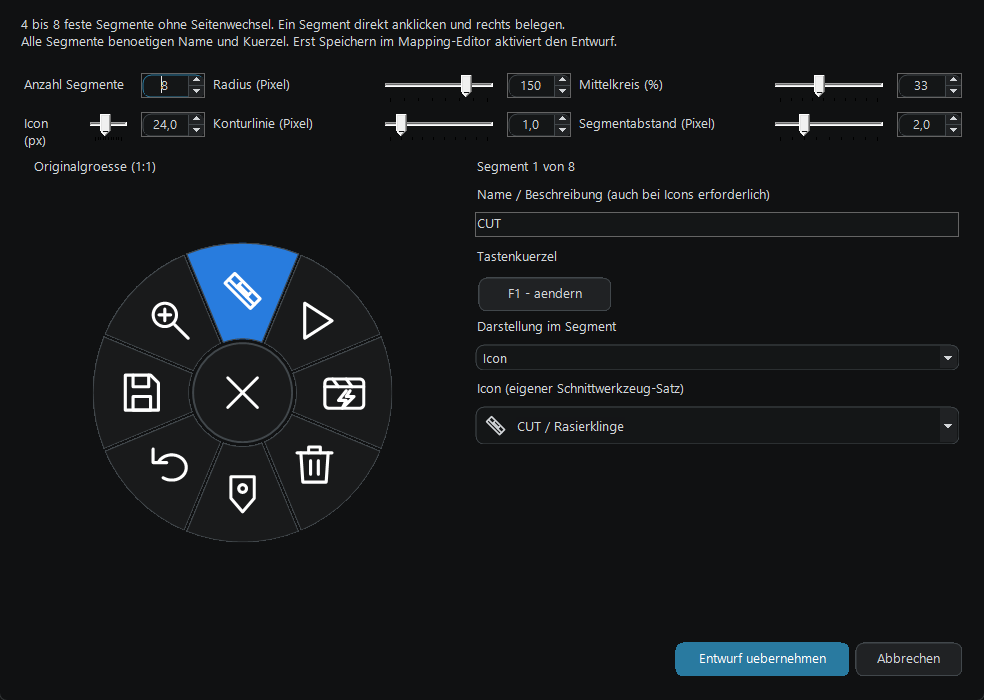
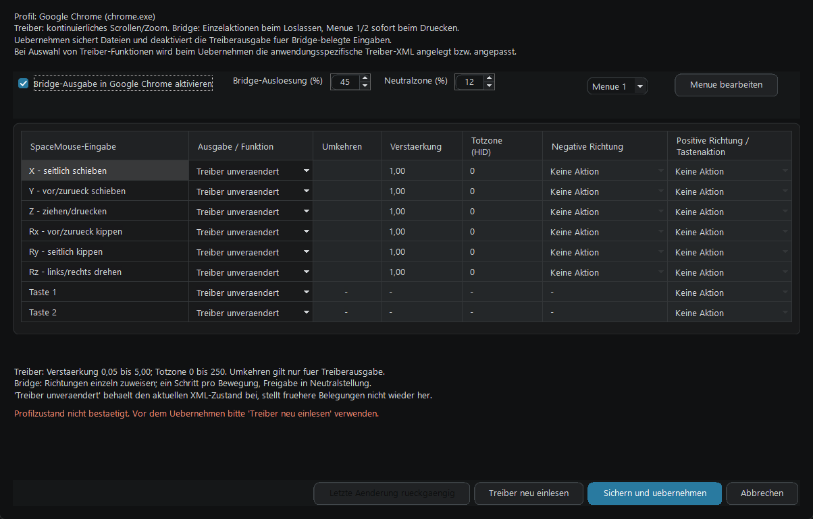
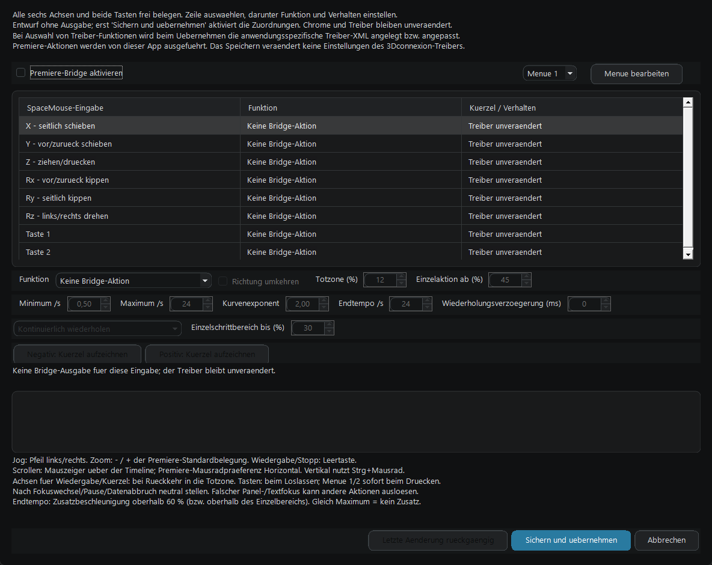
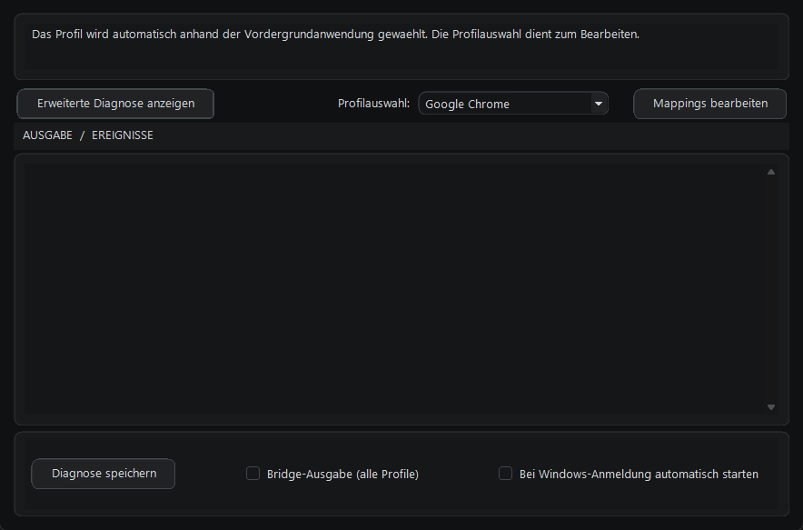

# Space Mouse Bridge for Premiere and more

Eine Windows-App, die eine 3Dconnexion SpaceMouse als konfigurierbares
Bediengeraet fuer **Adobe Premiere Pro** und **Google Chrome** nutzbar macht.
Die passende Belegung wird automatisch anhand der Vordergrundanwendung
ausgewaehlt. Der Schwerpunkt liegt auf feiner Timeline-Steuerung in Premiere,
frei belegbaren Achsen und Tasten sowie einer einheitlichen dunklen Oberflaeche.

## Funktionen im Ueberblick

- **Premiere Pro:** Jog / Abspielkopfsteuerung, horizontales und vertikales
  Timeline-Scrollen, Timeline-Zoom, Wiedergabe/Stopp und eigene Tastenkuerzel.
- **Einstellbare Kennlinien:** Totzone, Richtung, Geschwindigkeit,
  Kurvenexponent, Wiederholungsverhalten und Einzelbildbereich mit
  grafischer Vorschau.
- **Freie Belegung:** alle sechs Bewegungsachsen und beide unterstuetzten
  SpaceMouse-Tasten sowie ein konfigurierbares Bridge-Kontextmenue.
- **Chrome:** einzelne Browseraktionen wie Zurueck/Vorwaerts und ein
  konfigurierbares Bridge-Kontextmenue am Mauszeiger; kontinuierliches Scrollen
  und Zoom ueber das Chrome-Profil des Originaltreibers.
- **Konfigurierbare Radialmenues:** zwei unabhaengige Menues pro Chrome- und
  Premiere-Profil, frei auf die beiden SpaceMouse-Tasten legbar. Jeweils 4 bis 8
  vollstaendig belegte Segmente mit eigenen Tastenkuerzeln und wahlweise Text
  oder einem von 33 einfarbigen Werkzeug-/Aktionsicons. Ein visueller Editor
  zeigt das Menue in Originalgroesse und aktualisiert Aenderungen sofort.
  Radius (40 bis 180 Pixel), Mittelkreis, Konturen, Segmentabstand sowie
  getrennte Text- und Icongroessen sind pro Menue einstellbar.
  Das Menue erscheint am Mauszeiger; ein erneuter Tastendruck schliesst es
  wieder, mit 250 ms Schutz gegen unbeabsichtigtes Doppelausloesen.
- **Profilverwaltung:** getrennte Einstellungen, automatische Profilwahl,
  globaler Ausgabeschalter und lokale Sicherung/Ruecknahme beim Speichern.
- **Alltag und Diagnose:** Windows-Autostart, Tray-Menue und aufklappbare
  HID-Diagnose mit Ereignisprotokoll.

## Screenshots

Aktuelle Oberflaeche mit neutralen Beispielbelegungen; die gezeigten Shortcuts
im Radialmenue sind Beispiele und keine automatisch installierten Premiere-Befehle.

### Radialmenue mit Icon-Auswahl und Livevorschau

### Gemeinsame Eingabeliste im Chrome-Profil

### Premiere-Profil

### Hauptfenster

## Voraussetzungen und Funktionsweise

Windows x64 und .NET Framework 4.x werden benoetigt. Fuer die
treiberbasierten Chrome-Funktionen muss 3Dconnexion 3DxWare installiert sein.
Die Premiere-Aktionen fuehrt diese App ueber Tastatur-/Mausausgabe aus;
dafuer muessen die passenden Shortcuts und der Fokus in Premiere stimmen.
Die App muss laufen und die Bridge-Ausgabe aktiviert sein.

Bei Auswahl von Chrome-Treiberfunktionen legt **Uebernehmen** die
anwendungsspezifische Benutzer-XML an bzw. passt sie an, mit vorheriger
Sicherung. Ein blosser App-Start installiert keine persoenliche
Treiberkonfiguration. Premiere-Einstellungen veraendern keine Treiber-XML.
Treiberfunktionen koennen auch bei pausierter oder beendeter Bridge wirken.

## Hardware und Projektstatus

Lokales Windows-Programm fuer die SpaceMouse Wireless ohne Bluetooth,
getestet ueber den 3Dconnexion-USB-Funkempfaenger (VID 256F / PID C652).
Kein eigener Treiber, keine externen Bibliotheken und keine Administratorrechte.
CAD-/globale Treiberprofile und normales Mausrad werden nicht veraendert.
Andere Geraete und Treiberversionen sind nicht pauschal verifiziert.
Das Projekt ist eine unabhaengige Anwendung und kein offizielles Produkt
von 3Dconnexion, Adobe oder Google.

Beim Windows-Autostart bzw. beim Start mit `--tray` startet die App mit
ausgeblendetem Hauptfenster im Infobereich (Tray) neben der Uhr.
Per Doppelklick auf das Tray-Symbol oder ueber **Einstellungen oeffnen**
im Tray-Menue laesst sich das Fenster aufrufen. Das Schliessen des Fensters
blendet es nur aus; die App laeuft im Hintergrund weiter.
Ein manueller Start ohne `--tray` zeigt das Hauptfenster direkt an.

Die Geraeteauswahl (Navigation/Zusatzcollection), HID-Pfad, Achsenrohwerte,
Tastenreports und der letzte HID-Report befinden sich unter
**Erweiterte Diagnose anzeigen**. Dieser Bereich ist beim Start geschlossen.
Profilwahl, Ereignisprotokoll und Aktionen bleiben direkt erreichbar.
Die Aktionsbuttons stehen oben links und rechts, Autostart mittig dazwischen
und Bridge-Ausgabe darunter. Ein zusaetzlicher Erfolgsstatus entfaellt; Fehler und fehlender
Raw Input werden weiterhin in der Protokollueberschrift angezeigt.
Der Ausgabebereich ist in der Standardansicht halb so hoch wie zuvor;
das Hauptfenster ist entsprechend kompakter. Beim Oeffnen der erweiterten
Diagnose waechst das Fenster wieder auf die bisherige Hoehe.
Das Auf- und Zuklappen aendert weder die Eingabeverarbeitung noch die
Belegungen; Zusatzcollections werden im Hintergrund weiterhin verarbeitet.

## Anwendungsprofile

Die Bridge waehlt das passende Profil anhand des Prozesses im Vordergrund,
nicht anhand von Fenstertiteln. Aktuell sind zwei Profile vorbereitet:

| Profil | Erkennung | Stand |
|---|---|---|
| Google Chrome | `chrome.exe`, Fensterklasse `Chrome_WidgetWin_1` | Bisherige Belegungen und Mapping-Editor |
| Adobe Premiere Pro | `Adobe Premiere Pro.exe` | Alle sechs Achsen und beide Tasten frei belegbar |

Im Hauptfenster **Profil bearbeiten** auswaehlen und **Mappings bearbeiten**
oeffnen. Diese Auswahl bestimmt nur den Editor, nicht die aktive Anwendung.
**Vordergrundprofil** zeigt die tatsaechlich erkannte Anwendung und ihren
Ausgabestatus. Profilwechsel erscheinen auch im Ereignisprotokoll, damit
die Erkennung nach der Rueckkehr ins Bridge-Fenster nachvollziehbar bleibt.
Im Bridge-Fenster selbst und in anderen Anwendungen bleibt
die Ausgabe aus. Auch ein anderes Chrome-Fenster setzt die Gestenerkennung
zurueck; vorgemerkte Aktionen werden niemals in ein neues Fenster uebertragen.

Die Checkbox **Bridge-Ausgabe (alle Profile)** pausiert die gesamte Bridge.
Zusaetzlich gilt der gespeicherte Aktivierungsschalter jedes Profils. Ein
gesperrtes oder extern veraendertes Profil gibt keine Eingaben aus; andere
fehlerfreie Profile bleiben verfuegbar. Waehrend ein Editor offen ist, ist
die Bridge-Ausgabe fuer alle Anwendungen pausiert.

### Premiere: alle Eingaben konfigurieren

**Profil bearbeiten: Adobe Premiere Pro > Mappings bearbeiten** oeffnet
den neuen Editor fuer **X, Y, Z, Rx, Ry, Rz und Taste 1/2**. Eine Zeile
auswaehlen und darunter Funktion und Parameter einstellen:

| Funktion | Ausgabe / Bedienung |
|---|---|
| Keine Bridge-Aktion | Keine synthetische Ausgabe; die Originaltreiberbelegung bleibt unveraendert |
| Jog / Abspielkopf | Negative Richtung: Pfeil links; positive Richtung: Pfeil rechts |
| Timeline horizontal scrollen | Mausrad ohne Modifier, passend zur Premiere-Praeferenz **Horizontal** |
| Spuren vertikal scrollen | Strg + Mausrad, in der bestaetigten Premiere-Konfiguration bei derselben Horizontal-Praeferenz |
| Timeline-Zoom | Minus / Gleich-Taste der Premiere-Standardbelegung, **kein** Browser-Strg-Zoom |
| Wiedergabe / Stopp | Ein kompletter Leertasten-Tipp |
| Eigenes Tastenkuerzel | Pro Achsenrichtung ein separates aufgezeichnetes Kuerzel; pro Taste ein Kuerzel |
| Bridge-Menue oeffnen (nur Tasten) | Eigenes Premiere-Radialmenue am Mauszeiger |

Tastenkuerzel ueber die Aufzeichnen-Buttons aufnehmen: normale Taste,
optional mit Strg/Umschalt/Alt; Escape bricht die Aufzeichnung ab. Die
Aufzeichnung sendet nichts an Premiere. Eigene Premiere-Shortcuts koennen
von den genannten Standardbefehlen abweichen; dann **Eigenes Tastenkuerzel**
verwenden. Keine Mauszeigersteuerung oder Panel-Fokuserkennung.

## Ausfuehrung und Schutz vor Fehlbedienung

- Chrome-Hauptfenster und Premiere im Vordergrund erhalten nur die Aktionen
  ihres eigenen aktivierten Profils.
- Chrome: Einzelaktion pro Auslenkung; Halten wiederholt nicht. Erst neutral stellen,
  dann auslenken; ausgefuehrt wird beim Loslassen aller sechs Achsen.
- Keine kuenstliche Wartezeit. Vollstaendige HID-Reports werden vor der
  Gestenpruefung dekodiert, zusaetzliche Freigabepruefung alle 25 ms.
- Die Ausgabe wartet auf freigegebene Zusatztasten. Insbesondere wird Strg
  des Treiber-Zooms weder mitbenutzt noch losgelassen.
- Pro Bewegung ist hoechstens eine Aktion vorgemerkt. Bei gleichzeitig
  ausgeloesten Zuordnungen gewinnt die erste; nach 5 Sekunden ohne sichere
  Freigabe wird sie protokolliert verworfen.
- Fenster-/Quellen-/Empfaengerwechsel und Pause der Bridge verwerfen
  Vormerkungen. Tasten muessen nach einem Wechsel erst losgelassen werden.
- SendInput sendet Druecken und Loslassen gemeinsam; bei Fehlern wird nur
  die eigene noch gehaltene Eingabe freigegeben und die Ausgabe deaktiviert.
- Nur eine interaktive Instanz. Fenster offen lassen, Minimieren ist moeglich.
- Chrome-Kurzbefehle koennen von Seiten/Fokus beeinflusst werden. Zurueck/
  Vorwaerts braucht passenden Verlauf; Verlassen/Neuladen kann ungespeicherte
  Seiteneingaben verlieren lassen.
